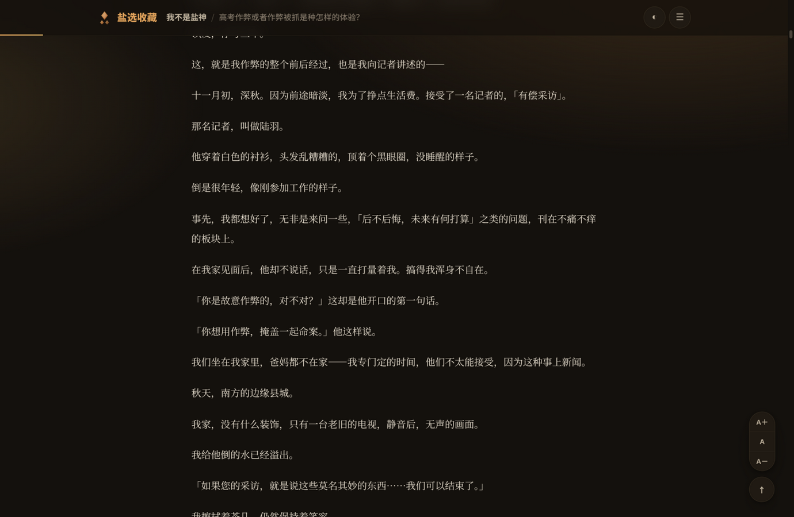
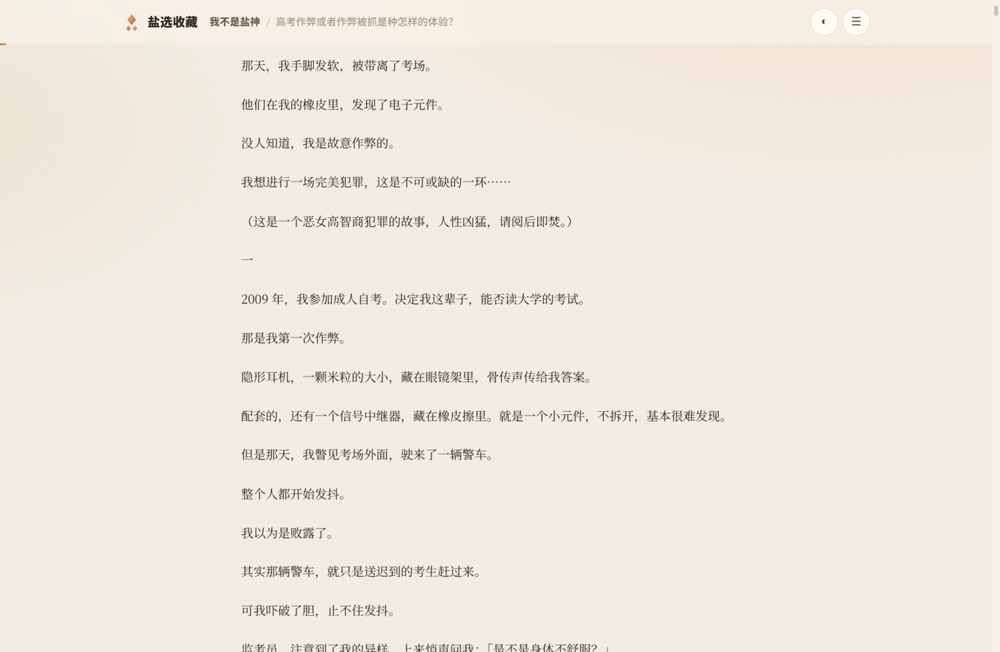
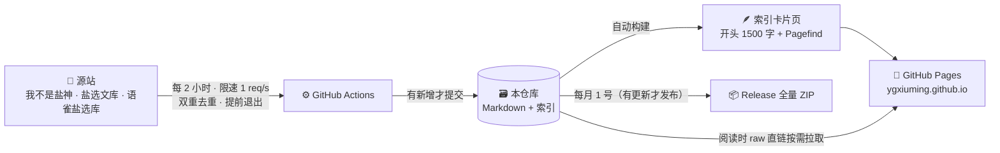

<div align="center">

# 🧂 知乎盐选文章收藏

**收集 · 清洗 · 在线阅读 · 自动同步** —— 一个会自己长大的盐选文章库

[](https://ygxiuming.github.io/Zhihu-Salt-Selected-Articles-Collection/)
[](https://github.com/ygxiuming/Zhihu-Salt-Selected-Articles-Collection)

[](https://github.com/ygxiuming/Zhihu-Salt-Selected-Articles-Collection/actions/workflows/deploy.yml)
[](https://github.com/ygxiuming/Zhihu-Salt-Selected-Articles-Collection/actions/workflows/sync.yml)
[](https://github.com/ygxiuming/Zhihu-Salt-Selected-Articles-Collection/tree/main)
[](https://github.com/ygxiuming/Zhihu-Salt-Selected-Articles-Collection/actions)
[](https://github.com/ygxiuming/Zhihu-Salt-Selected-Articles-Collection/releases)
[](https://github.com/ygxiuming/Zhihu-Salt-Selected-Articles-Collection)

[在线阅读](https://ygxiuming.github.io/Zhihu-Salt-Selected-Articles-Collection/) ·
[总目录](./目录.md) ·
[数据源](#-数据源) ·
[同步机制](#-自动同步机制) ·
[快照下载](https://github.com/ygxiuming/Zhihu-Salt-Selected-Articles-Collection/releases) ·
[本地开发](#%EF%B8%8F-本地开发)


</div>

---

> 由于该死的抖音老是推送，让我有时候想看盐选文章，但是又不甘心花这个钱。
> 所以一般都是从知乎盐选搬运工和我不是盐神的网站上进行观看的，在这感谢大佬的付出。
> 可能是由于网站的不稳定，有时候访问不了，所以创建该仓库收藏大佬网站上的文章。
> 仅供个人收藏，解解书瘾。如有其他意见，可联系本人，将会把该仓库转为私有。

## ✨ 特性

- 🎨 **全新阅读界面** — 「暖纸阅读 · 盐晶琥珀」设计：明暗双主题、衬线正文、阅读进度条、字号调节，偏好本地记忆
- 🔍 **中文全文搜索** — 标题 + 正文开头 1500 字建索引（Pagefind 分片按需加载，收录词高亮 + 子结果定位）
- ⚡ **标题即时筛选** — 「全部文章」浏览区支持关键词即时过滤与拼音首字母分组，万篇毫秒级响应
- 📡 **正文按需加载** — 文章页只内建开头 1500 字（即索引窗口），全文阅读时从 GitHub raw 直链拉取（jsDelivr 备用线路），**Pages 体积不随正文增长**
- 🔄 **全自动同步** — 每 2 小时增量抓取源站，新文章约 2 小时内自动上线
- 🧹 **深度清洗** — 去水印/去排版噪音/统一元数据，目录内链由文件系统生成，0 死链
- 📦 **全量快照** — 每月 1 号自动发布 ZIP 到 Releases（无更新则跳过），免克隆获取全量
- 🛡️ **多源容错** — 任一源站失联自动跳过，恢复后自动续传，互不阻塞

## 📖 三种阅读方式

**① 在线站点（推荐）** — 打开 [阅读站](https://ygxiuming.github.io/Zhihu-Salt-Selected-Articles-Collection/)，搜索框支持中文全文检索，浏览区支持标题即时筛选：

| 首页（浅色） | 阅读页（夜间） |
|:---:|:---:|
|  |  |

| 阅读页（浅色） | 首页（夜间） |
|:---:|:---:|
|  |  |

**② GitHub 内浏览** — 从 [目录.md](./目录.md) 进入，各源目录按拼音首字母分组（如 [我不是盐神/目录-A.md](./我不是盐神/目录-A.md)），内链直达 Markdown 原文。

**③ 全量下载** — [Releases](https://github.com/ygxiuming/Zhihu-Salt-Selected-Articles-Collection/releases) 每月发布全量 ZIP 快照。

## 📡 数据源

| 来源 | 状态 | 说明 |
|---|:---:|---|
| [我不是盐神](https://onehu.xyz/) | ✅ 活跃 | 最老牌盐选站，每日增量同步 |
| [盐选文库](https://www.yanxuanwk.com/) | ✅ 静态归档 | 收录 1.1 万+ 篇，免登录 |
| [知乎搬运工](https://www.zhbyg.top/) | ⚠️ 常失联 | 存量 7000+ 篇，恢复后自动续传 |
| [语雀·知乎盐选库](https://www.yuque.com/dayuyu-ualcu/azo1ge) | 🧪 已停更 | 1000+ 篇精选全文（登录态导入） |

各源文章**跨源自动去重**（标题归一化指纹 + 原文 URL 双保险）。

## 🔄 自动同步机制



- **增量友好**：列表页严格按时间倒序，连续 5 页无新增即提前结束，单次扫描分钟级
- **永不漏抓**：URL 与标题指纹双重去重替代断点标记，对漏抓免疫
- **防禁用**：定时任务临近 GitHub「60 天无活动」限制时自动空提交保活
- **产物校验**：CI 构建后全量扫描 HTML 完整性，Hugo 渲染竞态导致的偶发坏页自动触发重建
- **容量预案**：站点/仓库/快照三层限额的分级应对方案见 [docs/存储与扩容预案.md](./docs/存储与扩容预案.md)

## 📁 仓库结构

```
├── 我不是盐神/ 知乎搬运工/ 盐选文库/ 语雀盐选库/   # 四源文章（front matter + 规范正文）
│   └── 目录-*.md                                   # 拼音首字母分组目录（脚本生成，永不失配）
├── 目录.md               # 总目录入口
├── data/
│   ├── articles_index.json   # 全库元数据索引（去重 / 目录生成 / 浏览筛选，含站点永久链接）
│   ├── stats.json            # 统计（本页徽章数据源）
│   └── progress/             # 各源同步进度
├── scripts/              # 迁移 / 校验 / 同步工具链（Python）
│   ├── cleanlib.py       #   清洗与规范化共享库（含 Hugo slug 复现）
│   ├── catalog.py        #   索引 / 目录 / 统计生成
│   ├── validate.py       #   五项校验（内链 / 文件名 / 元数据 / 残留 / 收录）
│   ├── verify_site.py    #   构建产物完整性校验（CI 用）
│   └── sync/             #   同步框架 + 四源适配器
├── layouts/ static/ hugo.toml   # 静态站（暖纸主题 / 按需正文 / 即时筛选 / 搜索）
└── .github/workflows/    # 同步 / 部署 / 快照 三个工作流
```

## 🛠️ 本地开发

```bash
# 环境要求：Python 3.12+（uv）、Hugo extended ≥0.154、Node 20+
uv venv && uv pip install -r scripts/requirements.txt

# 校验仓库（内链 / 文件名 / 元数据 / 清洗残留 / 收录完整性）
uv run python scripts/validate.py

# 手动同步（增量，默认每源限 800 篇；--limit 0 为不限）
uv run python scripts/sync/run_sync.py --sources yanshen --limit 50

# 本地建站预览（串行渲染规避 Hugo 并发竞态，构建后校验产物）
GOMAXPROCS=1 hugo --minify --gc && python3 scripts/verify_site.py public \
  && npx -y pagefind@1.5.2 --site public
python3 -m http.server -d public 8000
```

## ⚖️ 免责声明

本仓库及站点内容均收集自公开网络（知乎盐选专栏的第三方搬运站），仅供个人收藏学习，不提供任何下载牟利渠道，版权归原作者与知乎所有。如有侵权请联系，将立即转为私有或删除。

---

<div align="center">

**如果这个仓库对你有帮助，欢迎 Star ⭐ 让更多人看到**

</div>
